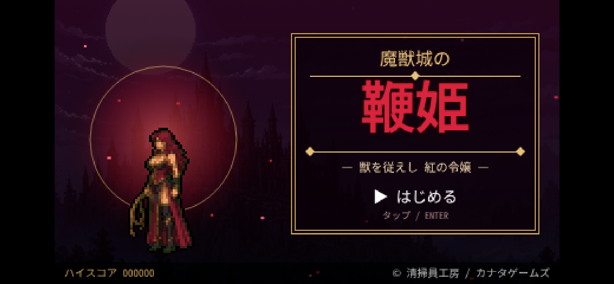

# 魔獣城の鞭姫



悪魔城風の2D横スクロールアクションゲームです。主人公は獣使いの令嬢ロザリンデ。鞭とサブウェポンを駆使して魔獣の城を攻略します。ブラウザだけで動き、スマホのブラウザ（タッチ操作）にも対応しています。

## 遊び方

`index.html` をブラウザで開くだけで遊べます（画像はすべて埋め込み済み、外部ファイル不要）。

- ステージ1「城」→ ボス「ファントムバット」
- ステージ2「月夜の庭園」→ ボス「茨の魔女」
- 道中の安全部屋にいるセレスティアに話しかけると、HP回復とゴールドでの強化（最大HP・鞭の威力と長さ・サブウェポン同時数）ができます。
- 燭台を壊すとハートやサブウェポン（ナイフ・斧・聖水）が出ます。

## 操作方法

| 操作 | キーボード | スマホ |
|---|---|---|
| 移動 | ← → | 画面の十字ボタン |
| しゃがむ / 階段 | ↓ / ↑ | 十字ボタン |
| ジャンプ | Z / スペース | ジャンプボタン |
| 鞭攻撃 | X | 攻撃ボタン |
| サブウェポン | C（または ↑＋攻撃） | サブボタン |
| スタート / 会話を進める | Enter | 画面をタップ |

## ビルド方法

ゲーム本体のソースは `game.src.js`、ドット絵素材は `assets/` にあります。素材を埋め込んだ `index.html` を生成するには：

```sh
python3 build.py
```

`test.py`、`t3.py`〜`t5.py` は Playwright（Chromium）を使った動作確認スクリプトです。

```sh
pip install playwright && playwright install chromium
python3 test.py
```

## クレジット

- 制作：清掃員工房 / カナタゲームズ
